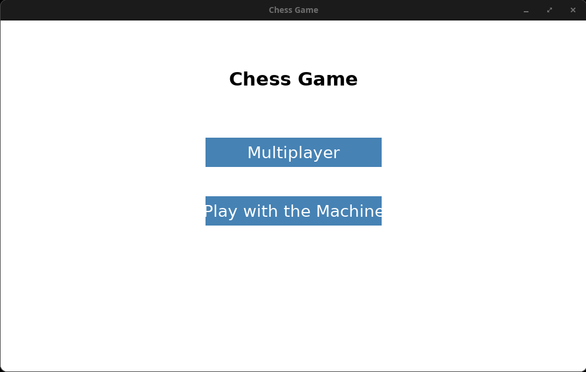
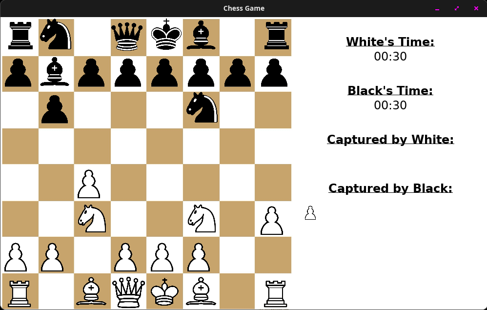

# Chess-game


## Description

This project is a fully functional, interactive graphical chess game built with Python 3 and Pygame. It provides a complete chess experience with strict enforcement of standard chess rules, real-time match statistics, and an integrated graphical user interface.

Players can enjoy a local 1v1 multiplayer mode or challenge a computer-based AI opponent. The built-in AI utilizes the Minimax algorithm with Alpha-Beta pruning to evaluate board states and make intelligent decisions, offering a challenging match for players.

## Features

* **Dual Game Modes:** Choose between playing against a friend locally (Multiplayer) or testing your skills against the machine (AI).
* **Smart AI Opponent:** Features an AI that uses Alpha-Beta pruning and a static evaluation function based on standard piece values (Pawn=1, Knight/Bishop=3, Rook=5, Queen=9).
* **Interactive GUI:** A clean graphical interface built with Pygame that supports mouse clicks for moving pieces, highlights selected squares, and provides a main menu to choose sides (Play as White or Black).
* **Live Match Dashboard:** A dynamic side panel that tracks both players' elapsed time and visually displays captured pieces.
* **Strict Rule Enforcement:** Powered by the `python-chess` library, it automatically handles legal move validation, pawn promotion, checkmates, and advanced draw conditions (stalemate, insufficient material, 75-move rule, fivefold repetition).

## Screenshots

| Main Menu | Match Gameplay & Dashboard |
| :---: | :---: |
|  |  |

## Tech Stack

* **Language:** Python 3
* **Graphics & GUI:** Pygame
* **Chess Logic Engine:** `python-chess` (imported as `chess`)

## Getting Started

### Prerequisites

* Ensure you have Python 3.8 or higher installed. It is recommended to use a virtual environment.
* **Linux Users (Arch Linux / Ubuntu / Debian):** If your Python version (such as Python 3.13 or 3.14) builds `pygame` from source, ensure you have the SDL2 development libraries installed for image and font support:
  * **Arch Linux:** `sudo pacman -S sdl2_image sdl2_ttf sdl2_mixer`
  * **Ubuntu / Debian:** `sudo apt install libsdl2-image-dev libsdl2-ttf-dev libsdl2-mixer-dev`
  * *Alternatively, install `pygame-ce` which includes updated wheels:* `pip install pygame-ce`

### Installation

1. **Clone the repository:**
   ```bash
   git clone https://github.com/cl4sic/Chess-game.git
   cd Chess-game
   ```

2. **Create and activate a virtual environment (recommended):**
   * On Linux/macOS:
     ```bash
     python3 -m venv venv
     source venv/bin/activate
     ```
   * On Windows:
     ```bash
     python -m venv venv
     venv\Scripts\activate
     ```

3. **Install the dependencies:**
   ```bash
   pip install -r requirements.txt
   ```

## Running the Game

To start the game, run the main Python script from the root of the project:

```bash
python chess_game.py
```

## How to Play

1. **Main Menu:**
   * Select **Multiplayer** to play against a friend locally on the same computer.
   * Select **Play with the Machine** to play against the AI, then choose your side (**Play as White** or **Play as Black**).
2. **Move Pieces:**
   * Click on a piece to select it (it will be highlighted in yellow).
   * Click on a valid destination square to make your move. Only legal chess moves are accepted.
   * Pawn promotion automatically promotes to a Queen (`q`).
3. **Side Panel:**
   * Tracks each player's elapsed match time and displays captured pieces.
4. **Game Over:**
   * When checkmate, stalemate, or any draw condition occurs, a summary is displayed along with a button to return to the main menu.

